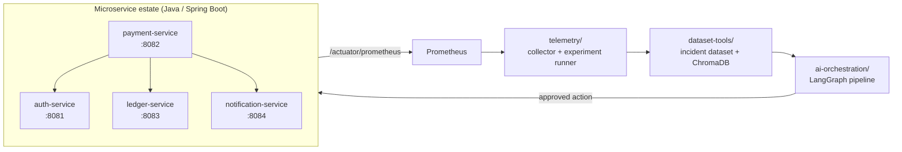
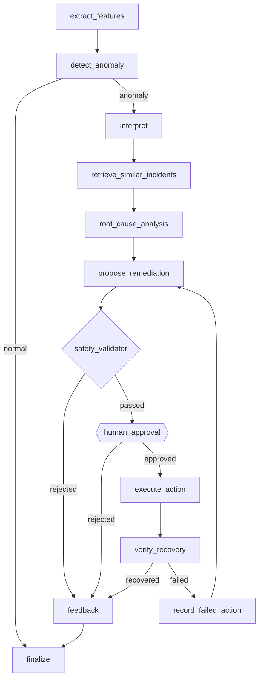

# AIOps Self-Healing Microservices Platform

A multi-agent system that takes one telemetry record from a microservice estate, detects whether it
is anomalous, works out **which service is actually at fault** (not merely which one is showing
symptoms), proposes a remediation, requires a human to approve it, executes it, and verifies that
the fault actually cleared.

> **Scope, stated precisely:** detection and diagnosis run **per record**. The pipeline is invoked
> from the Streamlit console or the evaluation harness; there is no continuous monitor feeding
> collector output into the graph, and no incident deduplication across records. A standing
> monitor loop is the next step, not a shipped feature.

The problem it targets is **cross-service fault attribution**. When a payment service starts
returning 5xx errors, the payment service is frequently not the thing that is broken — the auth
service it depends on is. Naïve retrieval-based approaches reliably name the symptom service,
because historical incidents are indexed by where the pain appeared.

**Headline result.** On 48 held-out incidents, against a single-agent baseline sharing every
non-diagnostic component:

| | Multi-agent | Single-agent baseline |
|---|---|---|
| Accuracy when answered | **100%** (10/10) | 60% (6/10) |
| **Cross-service faults** | **100%** (4/4) | **0%** (0/4) |
| Same-service faults | 100% (6/6) | 100% (6/6) |
| Macro F1 | 1.00 | 0.42 |
| Mean latency per incident | 8.53 s | 2.12 s |

The two arms are **identical** on same-service faults. The entire difference sits in exactly the
cases the dataset was built to isolate.

**Why.** On every cross-service incident, retrieval returned incidents rooted at the *symptom*
service — it disagreed with the correct answer every time. The baseline followed it. The multi-agent
pipeline did not, because its architecture forbids retrieval from overriding a deterministic
signature match. The design rule *"retrieved incidents are evidence, not commands"* is the whole
measured difference between the arms.

> **Read the limitations before citing any of this.** The corpus is fully synthetic, detection —
> not diagnosis — is the real ceiling (both arms abstained on 79.2% of incidents), and several
> headline metrics are unmeasurable by replay and are reported as such rather than fabricated.
> See [Limitations](#limitations).

---

## Architecture



Four Spring Boot services with a real dependency chain, each carrying one controlled, resettable
fault. Telemetry is scraped into a labelled incident dataset, which feeds a 13-node LangGraph
pipeline that diagnoses and remediates.

### The pipeline



Three properties are worth noting:

**Human approval is genuinely mandatory.** It uses LangGraph's `interrupt()`, so the graph cannot
proceed without an external approve/reject signal. State is checkpointed, so a run survives the
process dying and resumes exactly where it paused. Every retry needs its own fresh approval.

**Safety validation is fully deterministic** — zero LLM calls on that path. It collects *every*
violated rule rather than stopping at the first, so rejection reasons are complete. High-risk actions
against `ledger-service` are never permitted, because it holds financial state.

**Failure is a first-class path.** A failed verification routes back through `record_failed_action`,
so the next proposal knows what already failed. A safety rejection still goes through `feedback`
rather than straight to `finalize` — rejections are learned from too.

---

## Quickstart

Requires **JDK 17**, **Python 3.10+**, and **Docker**.

```bash
docker compose up -d --build
```

That builds all four services plus PostgreSQL on one network. Then drive a payment end to end:

```bash
TOKEN=$(curl -s -X POST http://localhost:8081/api/auth/login \
  -H "Content-Type: application/json" \
  -d '{"username":"alice","password":"alice-pass"}' | python -c "import sys,json;print(json.load(sys.stdin)['token'])")

curl -X POST http://localhost:8082/api/payments \
  -H "Authorization: Bearer $TOKEN" -H "Content-Type: application/json" \
  -d '{"accountId":"acct-42","currency":"USD","amount":150.25}'
```

Inject a fault and watch it surface in the metrics:

```bash
curl -X POST http://localhost:8083/inject-db-lock
curl -s http://localhost:8083/actuator/prometheus | grep hikaricp_connections
curl -X POST http://localhost:8083/reset-db-lock
```

Then run the AI pipeline against it:

```bash
cd ai-orchestration
python -m venv .venv && .venv/Scripts/activate      # Windows
# python3 -m venv .venv && source .venv/bin/activate  # macOS / Linux
pip install -r requirements.txt && pip install -e .

ollama pull llama3.2:3b          # the model the published evaluation used
python -m ai_orchestration.anomaly.train
streamlit run app.py             # approval console on :8501
```

> **JDK 17, not 23.** Spring Boot 3.3.4 pins Lombok 1.18.34, whose annotation processor does not run
> on JDK 23. Only `ledger-service` uses Lombok, so the other three compile fine and ledger fails
> alone with `cannot find symbol` errors on generated getters — which look like code bugs but are
> not. The Dockerfiles pin 17 already.

---

## Repository layout

| Path | What it holds |
|---|---|
| `auth-service/` `payment-service/` `ledger-service/` `notification-service/` | The four Spring Boot services, one controlled fault each |
| `telemetry/` | Metric collector and the NORMAL → FAULT → RECOVERY experiment runner |
| `dataset-tools/` | Incident dataset construction, deterministic splitting, ChromaDB memory |
| `ai-orchestration/` | Anomaly detection, RCA, retrieval, safety, execution, the LangGraph graph, evaluation harness |
| `docs/paper/` | The IEEE manuscript, figures, and section sources |
| `docs/evaluation/` | Results, metrics, per-incident CSV, ablations, negative control |
| `k8s/` | Kubernetes manifests, including in-cluster Prometheus |
| `CLAUDE.md` | Permanent project rules (safety invariants, rule 22, etc.) |

Each subdirectory has its own README with full detail.

---

## The four faults

Each service carries exactly one fault. All are **disabled by default, safe, and resettable** — with
matching `/inject-*`, `/reset-*` and `/fault-status` endpoints.

| Fault | Injected into | Symptom appears on | Metric that moves |
|---|---|---|---|
| `auth-key-error` | auth-service | **payment-service** | `http_server_requests` 5xx |
| `notification-latency` | notification-service | **payment-service** | request duration |
| `memory-leak` | payment-service | payment-service | `jvm_memory_used_bytes` |
| `db-lock` | ledger-service | ledger-service | `hikaricp_connections_*` |

The first two are the cross-service cases, and they are the reason the project exists. `db-lock`
holds 9 of the 10 HikariCP connections — deliberately never all 10, so the service degrades but
still answers, which is considerably harder to diagnose than a service that is simply down.

```bash
curl -X POST http://localhost:8081/inject-auth-key-error   # then reset-auth-key
curl -X POST http://localhost:8082/inject-memory-leak      # then reset-memory-leak
curl -X POST http://localhost:8083/inject-db-lock          # then reset-db-lock
curl -X POST http://localhost:8084/inject-latency          # then reset-latency
```

---

## Services

All four expose Spring Boot Actuator at `/actuator/health`, `/actuator/prometheus`,
`/actuator/metrics`, plus `/liveness` and `/readiness` sub-paths used by the Kubernetes probes. All
four read, log, propagate and return `X-Correlation-Id`.

**auth-service** (`:8081`) — issues and validates JWTs against an in-memory user store (`alice` /
`alice-pass`, `bob` / `bob-pass`).
`POST /api/auth/login` · `POST /api/auth/validate`
Env: `SERVER_PORT`, `JWT_SECRET`, `JWT_EXPIRATION_MS`

**payment-service** (`:8082`) — orchestrates the full chain: validate JWT → debit ledger → send
receipt. A notification failure is deliberately **not** a payment failure, since the money has
already moved; it reports `notificationStatus: "FAILED"` instead. That asymmetry is what lets a
notification root cause surface as a payment symptom.
`POST /api/payments`
Env: `AUTH_SERVICE_URL`, `LEDGER_SERVICE_URL`, `NOTIFICATION_SERVICE_URL`, `*_TIMEOUT_MS` (5000)

**ledger-service** (`:8083`) — accounts and debit/credit against PostgreSQL inside real
`@Transactional` boundaries with pessimistic row locking. Seeds `acct-42` with 1000.00 USD.
`POST /api/accounts` · `GET /api/accounts/{id}` · `POST /api/ledger/debit` · `POST /api/ledger/credit`
Env: `DB_URL`, `DB_USERNAME`, `DB_PASSWORD`, `DB_POOL_MAX_SIZE` (10), `SEED_DEMO_ACCOUNT`

**notification-service** (`:8084`) — simulates sending a receipt. No real integration.
`POST /api/notifications/receipt`
Env: `SERVER_PORT`, `NOTIFICATION_LATENCY_DEFAULT_DELAY_MS` (6000)

---

## How it was evaluated

68 incidents, split deterministically (seed 42, stratified by fault type) into a **20-incident Memory
set** and a **48-incident Evaluation set**. Evaluation incidents are hard-refused from retrieval
memory — CLAUDE.md rule 22, enforced at three independent layers plus a live pre-flight probe
recorded in every run's metrics.

Both arms share detection, retrieval and every downstream node. Only the diagnostic step differs:
deterministic signature matching plus an optional LLM narrative, versus one LLM call that must
produce the whole answer. That isolates agent decomposition rather than retrieval or safety.

**Ablations changed the conclusions, in an unflattering direction that is reported as such.**
Disabling retrieval entirely left all 48 multi-agent diagnoses *identical* — retrieval contributes
zero diagnostic accuracy here and moves only the confidence label. That sharpens the headline rather
than weakening it: the advantage came entirely from *refusing to defer* to retrieval, not from
anything retrieval supplied. For the single-agent baseline the same change collapsed same-service
accuracy from 6/6 to **1/6**, while *improving* cross-service accuracy from 0/4 to **2/4** —
retrieval was substituting for reasoning: right on same-service faults, systematically wrong on
cross-service ones. That the identical intervention leaves one arm untouched and reorganises the
other is itself evidence for the architectural claim.

**A negative control** measures the false-positive rate on healthy telemetry: **4.17%** in the normal
phase (2/48, 95% CI 1.2–14.0%), but **27.08%** during the recovery phase (13/48, CI 16.6–41.0%).
The second figure is a real weakness and is reported, not buried.

Artefacts: [`docs/evaluation/`](docs/evaluation/) · Manuscript: [`docs/paper/`](docs/paper/)

---

## Limitations

Stated as prominently as the results, because several of them bound the results.

**The corpus is fully synthetic.** All 48 evaluation incidents are `data_source: synthetic`. No
cluster was available on the run machine.

**The diagnostic thresholds and the synthetic generator share constants.** The absolute 100% is
bounded by that circularity. The *comparison* between arms is not, since both arms see the same data.

**Detection, not diagnosis, is the real ceiling.** Both arms abstained on 79.2% of incidents
(38/48). The accuracy figures describe only the 10 incidents that were answered.

**Isolation Forest saturates outside its training range.** A 2 GB heap scores identically to a 50 MB
one, because the trees' split points only exist where training data existed. Documented as a
limitation with a concrete mechanism rather than tuned away.

**MTTR, Recovery Success Rate and False Recovery Rate are not measurable by replay** and are reported
as unmeasurable rather than as a meaningless 100%.

**Unsafe-action prevention was removed from the contributions.** The measured count is 0 — dry-run
execution never failed, so the rule never had occasion to fire. Reporting it as demonstrated would
have been unearned.

**The config default model is `llama3.2:1b`, but the published evaluation ran `llama3.2:3b`**
(recorded in `metrics.json` as `environment.ollama_model`). Set `OLLAMA_MODEL=llama3.2:3b` to
reproduce the published numbers.

---

## Running it

<details>
<summary><b>Natively</b> (four terminals, PostgreSQL required)</summary>

```bash
cd auth-service         && mvn spring-boot:run
cd ledger-service       && DB_PASSWORD=aiops-dev-password mvn spring-boot:run
cd notification-service && mvn spring-boot:run
cd payment-service      && mvn spring-boot:run
```

PostgreSQL setup (macOS / Homebrew shown; any PostgreSQL 16 works):

```bash
brew install postgresql@16 && brew services start postgresql@16
psql -d postgres -c "CREATE ROLE aiops WITH LOGIN PASSWORD 'aiops-dev-password' CREATEDB;"
psql -d postgres -c "CREATE DATABASE ledger_db OWNER aiops;"
psql -d postgres -c "CREATE DATABASE ledger_db_test OWNER aiops;"
```
</details>

<details>
<summary><b>Docker Compose</b></summary>

```bash
docker compose up -d --build
docker compose logs -f
docker compose down
```

Compose PostgreSQL is on host port **5433** so it does not collide with a native instance;
containers reach it internally as `postgres:5432`. `JWT_SECRET` and `DB_PASSWORD` are overridable
via `.env` and default to dev-only placeholders.
</details>

<details>
<summary><b>Kubernetes / Minikube</b></summary>

```bash
minikube start --driver=docker --cpus=2 --memory=3500mb
docker compose build
for svc in auth-service ledger-service notification-service payment-service; do
  docker tag capstone_2026-$svc:latest aiops/$svc:0.1.0
done
```

`minikube image load` can silently keep a stale image under an existing tag — verified by comparing
image IDs between the host daemon and `minikube ssh -- docker inspect`. On every *rebuild*,
force-remove the old tag first or pods serve old code with no error at apply time:

```bash
kubectl scale deployment auth-service ledger-service notification-service payment-service --replicas=0
for svc in auth-service ledger-service notification-service payment-service; do
  minikube ssh -- "docker rmi -f aiops/$svc:0.1.0" || true
  minikube image load aiops/$svc:0.1.0
done
kubectl scale deployment auth-service ledger-service notification-service payment-service --replicas=1

kubectl create secret generic aiops-secrets \
  --from-literal=jwt-secret='dev-only-insecure-secret-key-change-me-1234567890' \
  --from-literal=db-password='aiops-dev-password'

kubectl apply -f k8s/
kubectl port-forward svc/prometheus 9090:9090   # /targets should show all four jobs up
```
</details>

<details>
<summary><b>Telemetry capture and dataset rebuild</b></summary>

```bash
cd telemetry && pip install -r requirements.txt
python -m telemetry.experiment notification-latency \
  --baseline-seconds 30 --fault-seconds 30 --recovery-seconds 30

cd ../dataset-tools && pip install -r requirements.txt && pip install -e .
python -m dataset_tools.build_dataset    # rebuild + split (seed 42)
python -m dataset_tools.chroma_store     # index the Memory set only
```
</details>

---

## Tests

| Suite | Test functions |
|---|---|
| `ai-orchestration` | 221 |
| `dataset-tools` | 52 |
| `telemetry` | 19 |
| Java (auth 12, ledger 18, notification 4, payment 13) | 47 |

```bash
cd ai-orchestration && python -m pytest tests/ -v
cd dataset-tools    && python -m pytest tests/ -v
cd telemetry        && python -m pytest tests/ -v
cd ledger-service   && mvn test        # needs PostgreSQL (ledger_db_test)
```

Python tests mock Ollama and use an isolated ChromaDB — never the project's real Memory collection.
None require a running cluster. `payment-service` uses OkHttp MockWebServer for its three
downstream services; `ledger-service` runs against real PostgreSQL with each test in a rolled-back
transaction.

One suite is worth calling out: **`test_paper_claims_match_artefacts.py`** re-derives every headline
figure in `docs/paper/` from `docs/evaluation/` and fails if the prose and the artefacts disagree.
It exists because they once did.

---

## Paper

The IEEE manuscript is in [`docs/paper/`](docs/paper/) — abstract, dataset construction,
methodology, results, discussion, related work, ablations, conclusion, seven figures, a defence
runbook, and a claim-by-claim novelty audit.

A note on related work: arXiv 2511.15755, originally identified as the closest competitor, has been
**withdrawn by its author** after an audit found its multi-agent arm's action list was a source
constant rather than model output. Since that is the natural failure mode of this architecture too,
[`docs/paper/05-related-work.md`](docs/paper/05-related-work.md) §5.2 carries an empirical
self-audit proving this system's scored output varies with input telemetry, backed by a permanent
regression test.

---

<details>
<summary><b>Development log</b> — the week-by-week build history</summary>

Preserved in [`docs/DEVELOPMENT-LOG.md`](docs/DEVELOPMENT-LOG.md): Weeks 1–4 services,
faults and observability; Week 5 telemetry collection; Week 6 dataset and ChromaDB; Week 7 anomaly
detection and the first LangGraph workflow; Week 8 RCA, RAG and remediation proposals; Week 9 safety
validator and the human-approval gate; Weeks 10–11 execution, verification and the single-agent
baseline; Weeks 12–14 evaluation and paper sections; Weeks 15–16 ablations, negative control and the
final manuscript.
</details>

## License and scope

Academic capstone project. The dev-only credentials in this repository (`JWT_SECRET`,
`DB_PASSWORD`, the seeded users) are placeholders and must not be used anywhere real.
