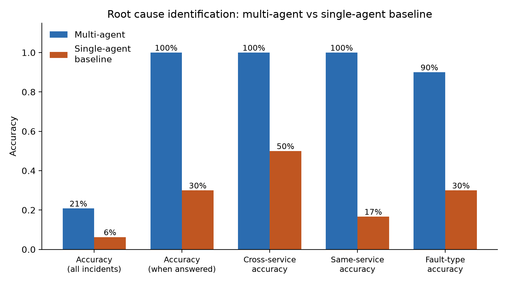
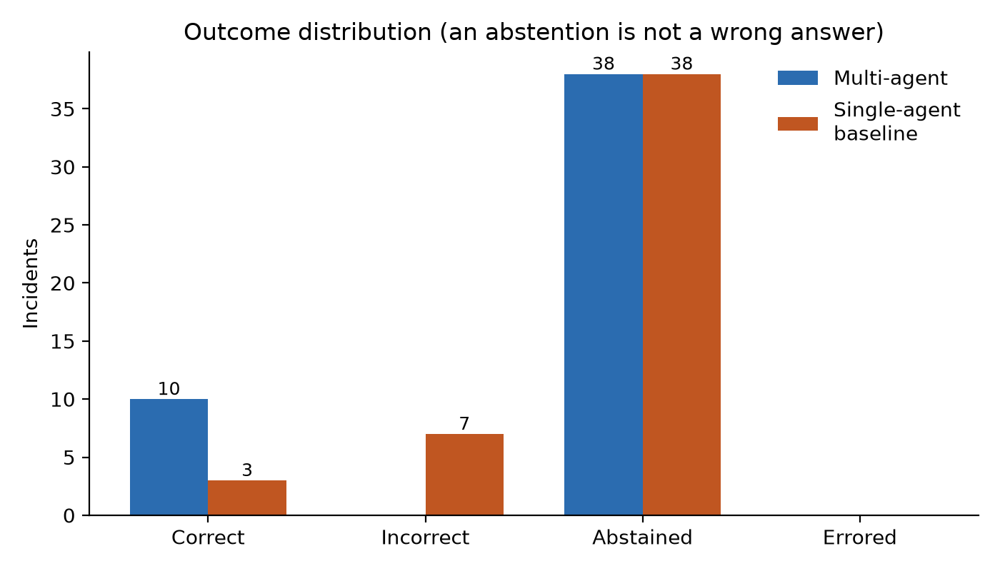
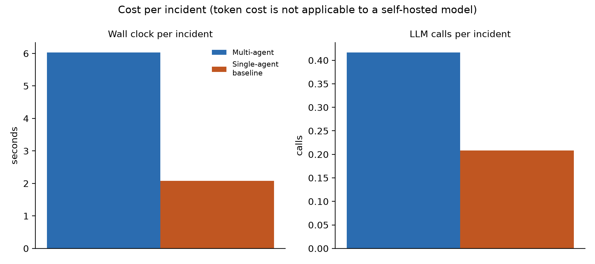

# Week 12 — Evaluation Results

Run started `2026-09-08T15:53:54.185465+00:00`, finished `2026-09-08T16:00:27.187502+00:00`, mode `replay`, operator policy `permissive`.

## What this run can and cannot establish

- **Environment:** Windows-11-10.0.26200-SP0, Python 3.12.2, Ollama model `llama3.2:3b` (reachable: True).
- **Trained detectors:** auth-service, ledger-service, notification-service, payment-service.
- **Execution:** dry run = `True`; feedback write-back enabled = `False`.
- **Recovery metrics measurable:** `False`. Recovery Success Rate and False Recovery Rate require a genuinely active fault to remediate. In replay mode nothing is executed (dry run), so they are not measurable and are reported as such rather than as a meaningless 100%.

## Dataset

- Evaluation incidents: **48** (held out; never in retrieval memory).
- By fault type: {'auth-key-error': 12, 'db-lock': 12, 'memory-leak': 12, 'notification-latency': 12}
- By data source: {'synthetic': 48}
- Cross-service incidents (root cause ≠ symptom service): **24**

## Preflight (leakage guard verified before measuring)

- `feedback_disabled`: True
- `rule_22_guard_verified_live`: True
- `rule_22_probe_incident_id`: inc-0014
- `rule_22_refusal_reason`: Incident 'inc-0014' belongs to the Evaluation set. Evaluation incidents must never enter RAG memory (CLAUDE.md rule 22), so this run was not written back.

## 1. Performance — root cause identification

| Metric | Multi-agent | Single-agent baseline |
|---|---|---|
| Accuracy (all incidents) | 20.8% | 6.2% |
| Accuracy (when it answered) | 100.0% | 30.0% |
| Abstention rate | 79.2% | 79.2% |
| Precision (macro) | 100.0% | 15.5% |
| Recall (macro) | 100.0% | 31.2% |
| F1 (macro) | 100.0% | 18.2% |
| Fault-type accuracy (when answered) | 90.0% | 30.0% |
| **Cross-service accuracy** | 100.0% | 50.0% |
| Same-service accuracy | 100.0% | 16.7% |
| Blamed the symptom service (cross-service) | 0 | 0 |
| Errored incidents | 0 | 0 |

*Cross-service accuracy is the headline capability: incidents where the service showing the symptom is not the service at fault. "Blamed the symptom service" counts the specific failure mode those incidents were designed to expose.*

## 2. System

| Metric | Multi-agent | Single-agent baseline |
|---|---|---|
| Detection latency, mean (s) — detection path only | 0.0062 | 0.0062 |
| Detection latency, median (s) | 0.005466 | 0.005466 |
| Time to approval pause, mean (s) — incl. diagnosis | 6.029 | 2.081 |
| Anomaly detection rate | 20.8% | 20.8% |
| MTTR, mean (s) | **not measurable here** (see note) | **not measurable here** (see note) |
| Executions attempted | 0 | 0 |
| Recovery success rate | **not measurable here** (see note) | **not measurable here** (see note) |
| False recovery rate | **not measurable here** (see note) | **not measurable here** (see note) |
| Remediation attempts, mean | 0.1875 | 0.1458 |

## 3. AI

| Metric | Multi-agent | Single-agent baseline |
|---|---|---|
| Wall clock per incident, mean (s) | 6.031 | 2.082 |
| LLM calls per incident, mean | 0.4167 | 0.2083 |
| LLM calls, total | 20 | 10 |
| Incidents with reasoning text | 10 | 10 |
| Hallucination: cited a metric absent from the evidence | 0.0% | 0.0% |
| **Hallucination: claimed a baseline-range value was elevated** | 0.0% | 0.0% |
| Response parse-issue rate | 0.0% | 0.0% |

*Token cost is not applicable to a self-hosted Ollama model; wall-clock inference time and LLM call count are reported in its place (documented methodology substitution).*

### Agent collaboration time

- Multi-agent mean: 6.031s
- Single-agent mean: 2.082s
- Multi-agent relative overhead: 189.7%
- Both arms share detection, retrieval and all downstream nodes; the difference is the diagnostic step (deterministic signature matching plus an optional LLM narrative, versus one LLM call that must produce the whole answer).

## 4. Infrastructure

**Not collected.** No Prometheus URL supplied. Infrastructure metrics require the deployed monitoring stack (kubectl port-forward svc/prometheus 9090), which is not part of a replay-only evaluation environment.

## 5. Human-in-the-loop

| Metric | Multi-agent | Single-agent baseline |
|---|---|---|
| Incidents reaching human approval | 10 | 10 |
| Approved | 10 | 10 |
| Rejected | 0 | 0 |
| Approval accuracy | 100.0% | 30.0% |
| **Unsafe actions prevented by Safety Validator** | 0 | 0 |
| Unsafe action prevention rate | 0.0% | 0.0% |
| Executions without approval (must be 0) | 0 | 0 |

*Under the 'permissive' simulated-operator policy this is definitionally equal to diagnostic accuracy among proposals that reached approval, so it is not an independent measurement. Reported for completeness and because it makes Unsafe Action Prevention interpretable - see evaluation/operator.py.*

## Raw log

Per-incident rows (every field, both arms) are in `per_incident_results.csv`; the full metric structure including per-class reports is in `metrics.json`. Both are the inputs Week 13-14's Results section is written from.

## Figures

