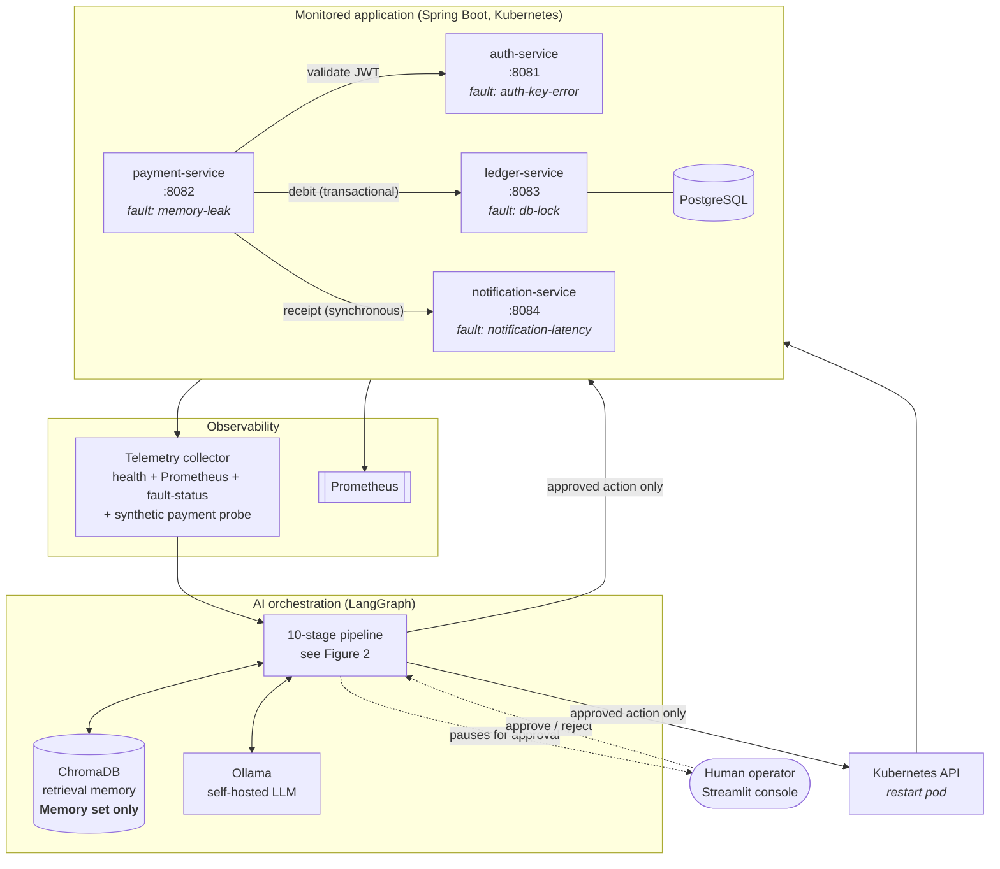
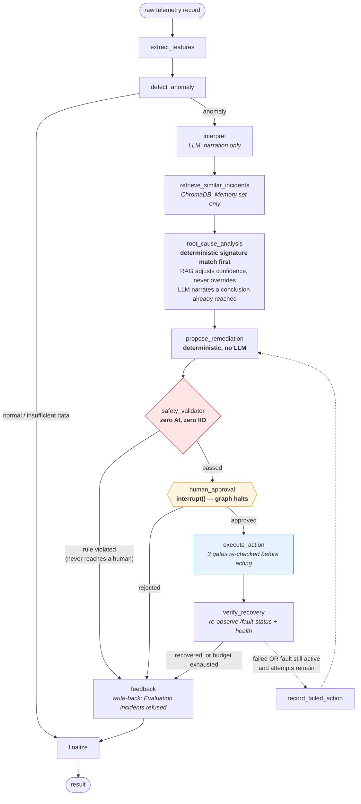
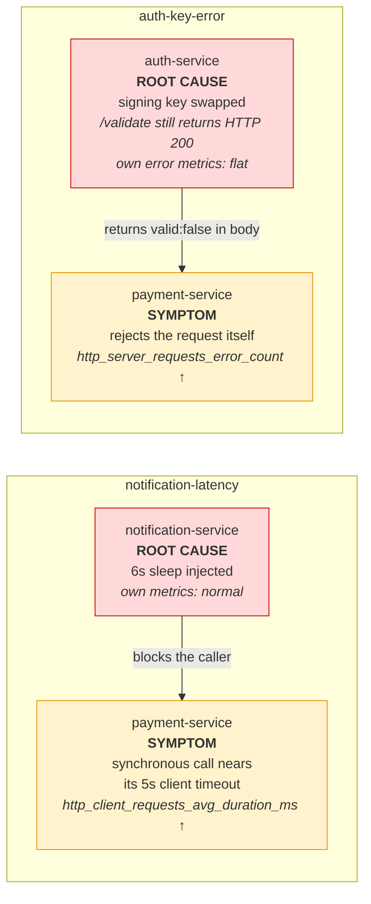
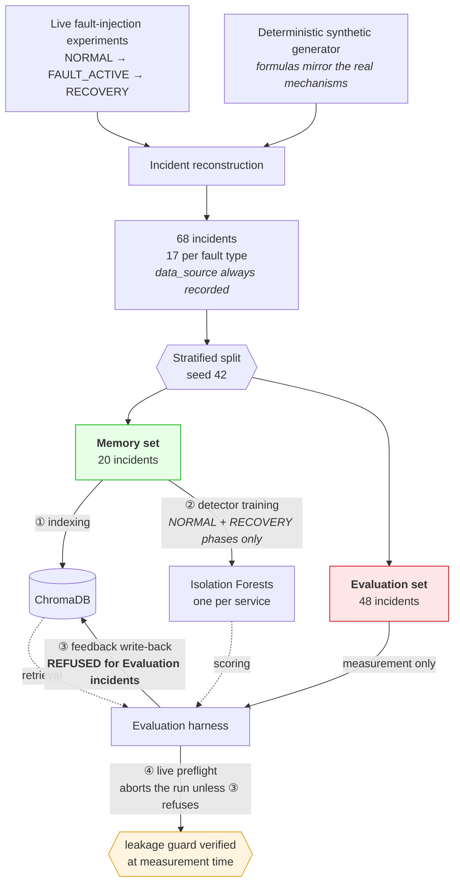
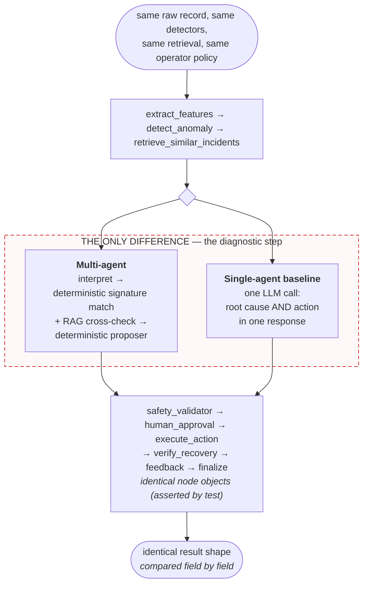

# Figures

Source-controlled diagram definitions for the paper. Mermaid is used rather than a binary `.drawio`
so the figures live in version control as text, diff meaningfully, and cannot drift silently from
the architecture they describe. Export to PNG/SVG for the submitted document; mirror into
`capstone_architecture.drawio` if a drawio artefact is required for submission.

Terminology here matches the implementation exactly — node names are the LangGraph node names in
`graph/workflow.py`, so a reader can move between figure and code without translation.

---

## Figure 1 — System architecture

The monitored application, the observability layer, and the AI orchestration layer.

---

## Figure 2 — The pipeline, with its control points

Solid arrows are the normal path; the dashed arrow is the failed-fix retry loop. Note that the retry
returns to *remediation*, not diagnosis, and that it re-enters both safety validation and human
approval.

---

## Figure 3 — Why cross-service faults are the hard case

The capability the evaluation is built around: the service reporting the anomaly is not the service
at fault. A system that blames the alarming service is wrong on half the fault types.

---

## Figure 4 — Dataset construction and the leakage barrier

Every arrow crossing the barrier is enforced in code, not by convention. The four enforcement points
are numbered as in Dataset Construction §4.6.

---

## Figure 5 — Experimental design: what differs between the arms

Everything outside the dashed box is the identical node object in both arms, imported rather than
reimplemented. Only the diagnostic step differs, which is what makes agent decomposition the
isolated variable.

